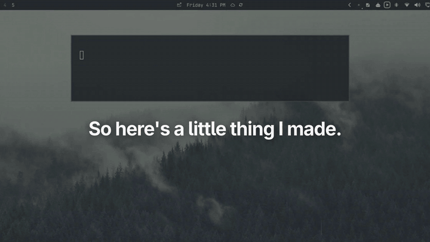

# Handy dictation for Omarchy

My dictation setup: [Handy](https://github.com/cjpais/Handy) running a local Parakeet model, with a tiny recording indicator in the Omarchy top bar instead of a floating window.



Press a key and talk. A red dot and a live waveform of your microphone show up next to the clock. Press again and it turns into a spinner while the text is transcribed, then the text is pasted where your cursor is and the widget disappears. Nothing sits on screen when you are not dictating.

## What you get

- **Handy 0.10.0**, checksum verified, unpacked under `~/.local/share/handy` and run as a systemd user service.
- **Parakeet TDT 0.6B v3 (Q8)** speech model, running on the CPU. Speech never leaves your machine.
- **The bar widget** (`handy.dictation`), an Omarchy shell plugin. Hidden when idle, 26 pixels wide when active. Clicking it also stops the recording.
- **A paste helper** that uses Ctrl+Shift+V in terminals (Ghostty, Alacritty, Kitty, foot and others) and Ctrl+V everywhere else, puts your previous clipboard back afterward, and refuses to paste if the focused window changed while you were talking.
- **Quiet start and stop sounds**: two soft 90 ms taps instead of the default marimba.
- **Shortcuts**: Super+Ctrl+X to start and stop, and F9 as hold-to-talk when F9 is free.
- **Optional LLM cleanup** of the transcript (filler words, punctuation, numbers, paragraphs) through OpenRouter. Off unless you ask for it.

## Requirements

Omarchy 4 (Hyprland with the Quickshell based `omarchy-shell` bar). Tested on Omarchy 4.0.4 and 4.0.6, x86_64. About 1 GB of disk space, most of it the model.

## Install

```sh
git clone https://github.com/campeterson41/handy-omarchy.git
cd handy-omarchy
./install.sh
```

No sudo. Everything goes under your home folder, and every config file the installer edits is backed up next to the original first.

Options:

| Option | What it does |
| --- | --- |
| `--with-cleanup` | Also install the LLM cleanup bridge. Asks for an OpenRouter API key. |
| `--cleanup-model ID` | OpenRouter model for cleanup. Default `anthropic/claude-haiku-5.5`. |
| `--bar-section NAME` | Put the widget in `left`, `center` or `right`. Default `center`, at the end. |
| `--no-f9` | Add only Super+Ctrl+X and leave F9 alone. |
| `--take-f9` | Use F9 for hold-to-talk even when something else already has it. |
| `--no-binds` | Add no shortcuts. Bind `~/.local/bin/handy-toggle` yourself. |
| `--no-model` | Skip the model download and pick a model inside Handy. |

Things to know:

- Super+Ctrl+X is Omarchy's built-in dictation shortcut. This setup takes it over. Uninstalling gives it back.
- F9 hold-to-talk is added only when F9 is free. Omarchy binds F9 to Voxtype when Voxtype is installed, so there you get Super+Ctrl+X only unless you pass `--take-f9`.
- To move the widget later, use the Omarchy bar settings or edit `bar.layout` in `~/.config/omarchy/shell.json`.
- Shortcuts live in `~/.config/hypr/handy-binds.lua`. Any key, mouse button or script can run `~/.local/bin/handy-toggle`. I use a spare mouse button.
- Run `handy` to open Handy's own window for the microphone and other settings.

## Optional cleanup

`./install.sh --with-cleanup` adds a small bridge on `127.0.0.1:18784` that Handy uses as its "Custom" post-processing provider. It exists so that:

- your OpenRouter key stays in the OS keyring (`secret-tool`), not in a settings file
- requests only go to zero data retention endpoints, at temperature 0
- your dictionary is sent along as spelling hints
- the bar widget can tell cleanup from transcription

If cleanup fails or times out, Handy pastes the raw transcript, so you never lose a dictation. The prompt is in [prompts/cleanup.txt](prompts/cleanup.txt) and shows up in Handy under Post Processing as "Dictation cleanup", where you can edit it. It includes a spoken escape hatch: say "transcription instructions", give an editing instruction, then "resume dictation".

With cleanup on, the transcript text is sent to OpenRouter. Audio never is.

### Dictionary

With cleanup on, keep names and terms in `~/.config/handy-omarchy/dictionary.txt`, one per line. The cleanup model uses them as spelling hints and only when you clearly said that name. The installer moves anything already in Handy's Custom Words into this file and empties Handy's list.

Avoid Handy's own Custom Words screen. Parakeet cannot take a vocabulary, so Handy compares every phrase you say against those words and swaps in anything that sounds close enough, before cleanup runs. Multiword entries are the worst. A business name that sounds like an everyday phrase gets pasted whenever you say something close to that phrase, so ordinary sentences come out with names in the middle of them. The bridge still reads words added there, but they turn that swapping back on, so move them to the file.

Without cleanup, Handy's Custom Words is the only dictionary there is. Keep it short and avoid entries that sound like everyday phrases.

## How it works

```
key press -> handy-toggle -> Handy records -> Parakeet transcribes -> (cleanup bridge) -> handy-paste
                                   |
               bar-status.py follows Handy's log and samples the mic
                                   |
                 $XDG_RUNTIME_DIR/handy-bar.json -> Dictation.qml in the bar
```

| File | Installed to | Job |
| --- | --- | --- |
| `bin/handy` | `~/.local/bin/handy` | Launcher. Tells the widget about a stop right away so the spinner appears instantly. |
| `bin/handy-paste` | `~/.local/bin/handy-paste` | Terminal-aware paste with clipboard restore. |
| `share/bar-status.py` | `~/.local/share/handy/` | Follows Handy's journal for recording start and stop, and measures microphone level with `parec` while recording. Audio stays in memory. |
| `plugin/handy.dictation/` | `~/.config/omarchy/plugins/` | The bar widget. |
| `share/cleanup-bridge.cjs` | `~/.local/share/handy/` | Optional cleanup bridge. Reads `~/.config/handy-omarchy/dictionary.txt`. |
| `systemd/*.service` | `~/.config/systemd/user/` | `handy`, `handy-bar`, and optionally `handy-cleanup`. |
| `scripts/apply-settings.py` | run by the installer | Merges the Handy settings this setup needs and leaves the rest alone. |

## Known limits

- The widget reads Handy 0.10.0's log lines. A newer Handy may word them differently, which is why the version is pinned.
- Handy does not report a progress percentage for dictation, so the spinner is indeterminate.
- If a recording has no speech in it, nothing is pasted and the spinner clears on its own after about 35 seconds.
- "Always-on microphone" in Handy must stay off, because the widget follows the microphone stream opening.
- Wayland and Hyprland only. The paste helper uses `hyprctl`, `wtype` and `wl-clipboard`.

## Uninstall

```sh
./uninstall.sh          # keeps your dictionary, history and the model
./uninstall.sh --purge  # removes those and the stored API key too
```

## Credits

[Handy](https://github.com/cjpais/Handy) by CJ Pais does all the real work. This repository is only the glue around it, and it is not affiliated with Handy or Omarchy. MIT licensed.
